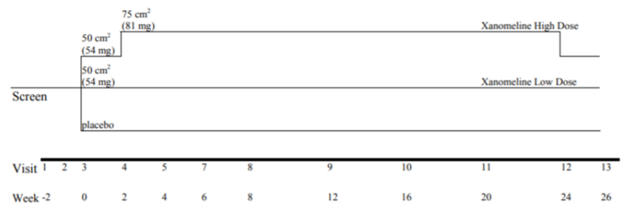



# Introduction

## Purpose

This document provides context for the analysis datasets and terminology that benefit from additional explanation beyond the Data Definition document (define.xml). In addition, this document provides a summary of ADaM conformance findings.

This completed example applies the R-specific structure in ADRG Template v2.0 and its accompanying completion guideline. Study metadata, analysis results, and QC findings are historical Pilot 3 content. Rendering this document does not execute the analysis programs or independently repeat the historical QC; environment restoration and execution instructions are provided in Appendix I.

## Study Data Standards and Dictionary Inventory

+-----------------------------+-----------------------------------------------+
| **Standard or Dictionary**  | **Versions Used**                             |
+=============================+===============================================+
| SDTM                        | SDTM Implementation Guide Version 3.1.2       |
+-----------------------------+-----------------------------------------------+
|                             | SDTM Version 1.2                              |
+-----------------------------+-----------------------------------------------+
|                             |                                               |
+-----------------------------+-----------------------------------------------+
| SDTM Controlled Terminology | CDISC SDTM Controlled Terminology, 2022-12-16 |
+-----------------------------+-----------------------------------------------+
|                             |                                               |
+-----------------------------+-----------------------------------------------+
| ADaM                        | ADaM-IG v1.1                                  |
+-----------------------------+-----------------------------------------------+
|                             | ADaM v2.1                                     |
+-----------------------------+-----------------------------------------------+
|                             |                                               |
+-----------------------------+-----------------------------------------------+
| ADaM Controlled Terminology | CDISC ADaM Controlled Terminology, 2022-06-24 |
+-----------------------------+-----------------------------------------------+
|                             |                                               |
+-----------------------------+-----------------------------------------------+
| Data Definitions            | Define-XML v2.0                               |
+-----------------------------+-----------------------------------------------+
|                             |                                               |
+-----------------------------+-----------------------------------------------+
| Medical Events Dictionary   | MedDRA version 8.0                            |
+-----------------------------+-----------------------------------------------+

## Source Data Used for Analysis Dataset Creation

The ADaM datasets were derived from SDTM version 1.2. For traceability, the SDTM is publicly available at the [PHUSE Github Repository](https://github.com/cdisc-org/sdtm-adam-pilot-project/tree/master/updated-pilot-submission-package/900172/m5/datasets/cdiscpilot01/tabulations/sdtm).

Which can be traced back to the original [CDISC SDTM & ADaM Pilot Project](https://github.com/cdisc-org/sdtm-adam-pilot-project).



# Protocol Description

## Protocol Number and Title

-   **Protocol Number:** CDISCPilot1
-   **Protocol Title:** Safety and Efficacy of the Xanomeline Transdermal Therapeutic System (TTS) in Patients with Mild to Moderate Alzheimer's Disease

The reference documents can be found [here](https://github.com/cdisc-org/sdtm-adam-pilot-project/blob/master/updated-pilot-submission-package/900172/m5/53-clin-stud-rep/535-rep-effic-safety-stud/5351-stud-rep-contr/cdiscpilot01/cdiscpilot01.pdf).

## Protocol Design in Relation to ADaM Concepts

### Objectives:

The objectives of the study were to evaluate the efficacy and safety of transdermal xanomeline, 50cm^2^ and 75cm^2^, and placebo in subjects with mild to moderate Alzheimer's disease.

### Methodology:

This was a prospective, randomized, multi-center, double-blind, placebo-controlled, parallel-group study. Subjects were randomized equally to placebo, xanomeline low dose, or xanomeline high dose. Subjects applied 2 patches daily and were followed for a total of 26 weeks.

### Number of Subjects Planned:

300 subjects total (100 subjects in each of 3 groups)

### Study schema:

{fig-align="center"}



# Analysis Considerations Related to Multiple Analysis Datasets

## Core Variables

Core variables are those that are represented across all/most analysis datasets.

| **Variable Name** | **Variable Description**              |
|-------------------|---------------------------------------|
| STUDYID           | Study Identifier                      |
| USUBJID           | Unique Subject Identifier             |
| SUBJID            | Subject Identifier for the Study      |
| SITEID            | Study Site Identifier                 |
| SITEGR1           | Pooled Site Group 1                   |
| TRTSDT            | Date of First Exposure to Treatment   |
| TRTEDT            | Date of Last Exposure to Treatment    |
| AGE               | Age                                   |
| AGEGR1            | Pooled Age Group 1                    |
| AGEGR1N           | Pooled Age Group 1 (N)                |
| RACE              | Race                                  |
| RACEN             | Race (N)                              |
| SEX               | Sex                                   |
| SAFFL             | Safety Population Flag                |
| ITTFL             | Intent-To-Treat Population Flag       |
| EFFFL             | Efficacy Population Flag              |
| COMP24FL          | Completers of Week 24 Population Flag |
| DSRAEFL           | Discontinued due to AE?               |

## Treatment Variables

ARM versus TRT01P

```         
  Are the values of ARM equivalent in meaning to values of TRT01P?

    Yes.
```

ACTARM versus TRT01A

```         
  If TRT01A is used, then are the values of ACTARM equivalent to values of TRT01A?

    Not applicable - ACTARM is not used.
```

Use of ADaM Treatment Variables in Analysis

```         
  Are both planned and actual treatment variables used in analysis?

    Yes. Planned treatment variables are used for study population and efficacy 
    analyses, whilst actual treatment variables are used for the safety analysis.
    All subjects received the treatment arm to which they were randomised and so
    the planned treatment is equivalent to the actual treatment for all subjects.
```

Use of ADaM Treatment Grouping Variables in Analysis

```         
  Are both planned and actual treatment grouping variables used in analysis?

    Not applicable - treatment grouping variables are not used.
```

## Use of Visit Windowing, Unscheduled Visits, and Record Selection

Was windowing used in one or more analysis datasets?

```         
  Yes
```

Were unscheduled visits used in any analyses?

```         
  Yes
```

## Imputation/Derivation Methods

For ASTDT in ADAE, this date was converted to numeric SAS date from AE.AESTDTC. If the day component is missing, a value of '01' is used. If both the month and day are missing no imputation is performed. See define.xml.



# Analysis Data Creation and Processing Issues

## Split Datasets

There were no datasets that required splitting due to size constraints.

## Data Dependencies

| **Analysis Dataset** | **Dependent on Following Analysis Datasets** |
|----------------------|----------------------------------------------|
| ADAE                 | ADSL                                         |
| ADTTE                | ADSL, ADAE                                   |
| ADADAS               | ADSL                                         |
| ADLBC                | ADSL                                         |

## Intermediate Datasets

No intermediate datasets were created for this trial.



# Analysis Dataset Descriptions

## Overview

The following provides detailed information for each analysis dataset included in the Pilot 3 submission, which were used to generate the outputs in Pilot 1. These ADaM datasets are ADSL, ADAE, ADTTE, ADADAS, ADLBC.

## Analysis Datasets

+----------------------------------------------+--------------------------------+----------+--------+-------------------------+-----------+-------------------------------------------------------------------------------+
| Dataset -                                    | Class                          | Efficacy | Safety | Baseline or other       | Primary   | Structure                                                                     |
|                                              |                                |          |        |                         |           |                                                                               |
| Dataset Label                                |                                |          |        | subject characteristics | Objective |                                                                               |
+==============================================+================================+==========+========+=========================+===========+===============================================================================+
|                                              |                                |          |        |                         |           |                                                                               |
+----------------------------------------------+--------------------------------+----------+--------+-------------------------+-----------+-------------------------------------------------------------------------------+
| ADSL - Subject-Level Analysis Dataset        | SUBJECT LEVEL ANALYSIS DATASET |          |        | x                       |           | One record per subject                                                        |
+----------------------------------------------+--------------------------------+----------+--------+-------------------------+-----------+-------------------------------------------------------------------------------+
|                                              |                                |          |        |                         |           |                                                                               |
+----------------------------------------------+--------------------------------+----------+--------+-------------------------+-----------+-------------------------------------------------------------------------------+
| ADADAS - ADAS-COG Analysis Dataset           | BASIC DATA STRUCTURE           | x        |        |                         | x         | One or more records per subject per analysis parameter per analysis timepoint |
+----------------------------------------------+--------------------------------+----------+--------+-------------------------+-----------+-------------------------------------------------------------------------------+
|                                              |                                |          |        |                         |           |                                                                               |
+----------------------------------------------+--------------------------------+----------+--------+-------------------------+-----------+-------------------------------------------------------------------------------+
| ADAE - Adverse Events Analysis Dataset       | OCCURRENCE DATA STRUCTURE      |          | x      |                         |           | One record per subject per adverse event                                      |
+----------------------------------------------+--------------------------------+----------+--------+-------------------------+-----------+-------------------------------------------------------------------------------+
|                                              |                                |          |        |                         |           |                                                                               |
+----------------------------------------------+--------------------------------+----------+--------+-------------------------+-----------+-------------------------------------------------------------------------------+
| ADLBC - Analysis Dataset Lab Blood Chemistry | BASIC DATA STRUCTURE           |          | x      |                         |           | One or more records per subject per analysis parameter per analysis timepoint |
+----------------------------------------------+--------------------------------+----------+--------+-------------------------+-----------+-------------------------------------------------------------------------------+
|                                              |                                |          |        |                         |           |                                                                               |
+----------------------------------------------+--------------------------------+----------+--------+-------------------------+-----------+-------------------------------------------------------------------------------+
| ADTTE - AE Time To 1st Derm. Event Analysis  | BASIC DATA STRUCTURE           | x        | x      |                         |           | One or more records per subject per analysis parameter per analysis timepoint |
+----------------------------------------------+--------------------------------+----------+--------+-------------------------+-----------+-------------------------------------------------------------------------------+

: {tbl-colwidths="\[18,17,10,10,17,10,18\]"}

### ADSL - Subject-Level Analysis Dataset

The subject level analysis dataset (ADSL) contains required variables for demographics, treatment groups, and population flags. In addition, it contains other baseline characteristics that were used in both safety and efficacy analyses. All patients in DM were included in ADSL. The following are the key population flags are used in analyses for patients:

-   SAFFL -- Safety Population Flag (all patients having received any study treatment)

-   ITTFL -- Intent-to-Treat Population Flag (all randomized patients)

### ADADAS - ADAS-COG Analysis Dataset

ADADAS contains analysis data from the ADAS-Cog questionnaire, one of the primary efficacy endpoints. It contains one record per subject per parameter (ADAS-Cog questionnaire item) per VISIT. Visits are placed into analysis visits (represented by AVISIT and AVISITN) based on the date of the visit and the visit windows.

### ADAE - Adverse Events Analysis Dataset

ADAE contains one record per reported event per subject. Subjects who did not report any Adverse Events are not represented in this dataset. The data reference for ADAE is the SDTM AE (Adverse Events) domain and there is a 1-1 correspondence between records in the source and this analysis dataset. These records can be linked uniquely by STUDYID, USUBJID, and AESEQ. Events of particular interest (dermatologic) are captured in the customized query variable (CQ01NAM) in this dataset. Since ADAE is a source for ADTTE, the first chronological occurrence based on the start dates (and sequence numbers) of the treatment emergent dermatological events are flagged (AOCC01FL) to facilitate traceability between these two analysis datasets.

### ADLBC - Analysis Dataset Lab Blood Chemistry

ADLBC contains one record per lab analysis parameter, per time point, per subject. ADLBC contains lab chemistry parameters and these data are derived from the SDTM LB (Laboratory Tests) domain. Two sets of lab parameters exist in ADLBC. One set contains the standardised lab value from the LB domain and the second set contains change from previous visit relative to normal range values. In some of the summaries the derived end-of-treatment visit (AVISITN=99) is also presented.

### ADTTE - AE Time To 1st Derm. Event Analysis

ADTTE contains one observation per parameter per subject. ADTTE is specifically for safety analyses of the time to the first dermatologic adverse event. Dermatologic AEs are considered an adverse event of special interest. The key parameter used for the analysis of time to the first dermatological event is with PARAMCD of "TTDE".



# Data Conformance Summary

## Conformance Inputs

Were the analysis datasets evaluated for conformance with CDISC ADaM Validation Checks?

```         
  Yes, Version of CDISC ADaM Validation Checks and software used: Pinnacle 21® 
  Community 4.0.2
```

Were the ADaM datasets evaluated in relation to define.xml?

```         
  Yes
```

Was define.xml evaluated?

```         
  Yes                     
```

## Issues Summary

+-------------+------------------------------------------------------------------------------+-------------+--------------------+-----------------------------------------------------------------------------------------------------------------------------------------------------------------------------------------+
| Check ID    | Diagnostic Message                                                           | Dataset     | Count (Issue Rate) | Explanation                                                                                                                                                                             |
+=============+==============================================================================+=============+====================+=========================================================================================================================================================================================+
| AD1012      | Secondary custom variable is present but its primary variable is not present | ADSL        | 1 (50.00%)         | This is a Sponsor Extension to the ADaM Model. The VISNUMEN \[End of Trt Visit (Vis 12 or Early Term.)\] variable is a integer variable which is not related to any character variable. |
+-------------+------------------------------------------------------------------------------+-------------+--------------------+-----------------------------------------------------------------------------------------------------------------------------------------------------------------------------------------+

: {tbl-colwidths="\[17,22,15,22,25\]"}

## QC Findings and Common Issues

In this Pilot 3 study, our focus was to create a subset of ADaMs based on the CDISCPILOT data, using R. We compared our R generated ADaMs against the CDISCPILOT ADaMs, created in SAS, as a QC step. With these comparisons we listed the QC Findings with explanations as to why these findings exist. We also came across common issues throughout the ADaM generation process, which could be helpful for improvements utilising the CDISC Pilot data in the future. These historical findings and known differences are retained in Appendix II and Appendix III; they are not results from rendering this document or rerunning the programs on the documentation-build machine.



# Submission of Programs

All programs for the analysis datasets and analysis outputs are submitted in R. The historical analysis environment and its documented package-management configuration are summarised below. Fields not recorded in the submitted materials are identified explicitly rather than inferred from the current documentation-build machine.

| Field | Analysis Environment |
|---|---|
| Language | R |
| Operating System / Platform | Linux; distribution and architecture were not specified in the historical ADRG or lockfile. |
| Software | R 4.2.3. The analysis IDE was not recorded; RStudio 2023.03.1+446.pro1 is specified only in the historical Windows reconstruction instructions. |
| Initial Date (Time = 0) for Software | 01 January 1970 |
| Management Tool (if applicable) | renv 0.17.0 with the Posit Package Manager CRAN snapshot dated 2023-03-15; the submitted snapshot is `renv-lock.txt`. |

## Analysis Dataset Programs

The following inventory was checked against the submitted programs and the analysis datasets in `analysis/adam/datasets`. Package names include both attached packages and packages accessed with `pkg::fun`; individual functions are not listed.

| Program Name | Output | Macro/Packages Used |
|---|---|---|
| adsl.r | adsl.xpt | admiral, dplyr, haven, janitor, metacore, metatools, pilot3utils, tidyr, xportr |
| adadas.r | adadas.xpt | admiral, dplyr, haven, metacore, metatools, pilot3utils, stringr, tibble, tidyr, xportr |
| adlbc.r | adlbc.xpt | admiral, dplyr, haven, metacore, metatools, stringr, tidyr, xportr |
| adae.r | adae.xpt | admiral, dplyr, haven, lubridate, metacore, metatools, stringr, tidyr, xportr |
| adtte.r | adtte.xpt | admiral, dplyr, haven, metacore, metatools, pilot3utils, tidyr, xportr |

## Analysis Output Programs

The output numbers and titles agree with the Pilot 3 summary report. File names in parentheses are the corresponding files in `analysis/output`; input datasets were checked against the programs.

| Program Name | Output Number | Title | Input Dataset |
|---|---|---|---|
| tlf-demographic.r | Table 14-2.01 (`tlf-demographic-pilot3.out`) | Summary of Demographic and Baseline Characteristics | ADSL |
| tlf-primary.r | Table 14-3.01 (`tlf-primary-pilot3.rtf`) | Primary Endpoint Analysis: ADAS Cog (11) - Change from Baseline to Week 24 - LOCF | ADSL, ADADAS |
| tlf-efficacy.r | Table 14-3.02 (`tlf-efficacy-pilot3.rtf`) | Primary Endpoint Analysis: Glucose (mmol/L) - Summary at Week 20 - LOCF: ANCOVA of Change from Baseline at Week 20 | ADSL, ADLBC |
| tlf-kmplot.r | Figure 14-1 (`tlf-kmplot-pilot3.pdf`) | Time to Dermatologic Event by Treatment Group: KM plot for Time to First Dermatologic Event (Safety population) | ADSL, ADTTE |



# Directory Structure

m1

└── cover-letter.pdf

└── report-tlf-pilot3.pdf

└── response-FDA-IR-pilot3.pdf

m5

└── sap-cdiscpilot01.pdf

└── datasets

    └── rconsortiumpilot3

        ├── tabulations

        \|   ├── sdtm

        \|   │   ├── blankcrf.pdf

        \|   │   ├── define-v1-updated-html.xsl

        \|   │   ├── define.pdf

        \|   │   ├── define.xml

        \|   │   ├── ae.xpt                      \# SDTM datasets in XPT format

        \|   │   ├── cm.xpt

        \|   │   ├── dm.xpt

        \|   │   ├── ds.xpt

        \|   │   ├── ex.xpt

        \|   │   ├── lb.xpt

        \|   │   ├── mh.xpt

        \|   │   ├── qs.xpt

        \|   │   ├── relrec.xpt

        \|   │   ├── sc.xpt

        \|   │   ├── se.xpt

        \|   │   ├── suppae.xpt

        \|   │   ├── suppdm.xpt

        \|   │   ├── suppds.xpt

        \|   │   ├── supplb.xpt

        \|   │   ├── sv.xpt

        \|   │   ├── ta.xpt

        \|   │   ├── te.xpt

        \|   │   ├── ti.xpt

        \|   │   ├── ts.xpt

        \|   │   ├── tv.xpt

        \|   │   └── vs.xpt

        └── analysis

        \|   ├── adam

        \|   │   ├── programs

        \|   │   │   ├── adadas.r

        \|   │   │   ├── adae.r

        \|   │   │   ├── adlbc.r

        \|   │   │   ├── adsl.r

        \|   │   │   ├── adtte.r

        \|   │   │   ├── tlf-demographic.r

        \|   │   │   ├── tlf-efficacy.r

        \|   │   │   ├── tlf-kmplot.r

        \|   │   │   ├── tlf-primary.r

        \|   │   │   └── renv-lock.txt

        \|   │   ├── datasets

        \|   │   │   ├── adrg.pdf

        \|   │   │   ├── adam-pilot-3.xlsx

        \|   │   │   ├── define.xml

        \|   │   │   ├── adadas.xpt

        \|   │   │   ├── adae.xpt

        \|   │   │   ├── adlbc.xpt

        \|   │   │   ├── adsl.xpt

        \|   │   │   ├── adtte.xpt

        \|   │   │   ├── define2-0-0.xsl



# Appendix I: Macros, Functions or Packages Submitted {.unnumbered}

The packages below are referenced by the submitted analysis programs. Versions for repository packages come from the official Pilot 3 `renv-lock.txt`; the `pilot3utils` version comes from its bundled DESCRIPTION. Dependencies are the direct Imports and Depends entries from the DESCRIPTION for each exact version, excluding R and base R packages. The lockfile remains the authoritative inventory for the complete transitive restoration environment.

| Macro/Function/Package Name | Version | Description/Purpose | Dependencies | Proprietary/Open-Source |
|---|---|---|---|---|
| admiral | 0.10.1 | ADaM derivations and analysis dataset programming. | admiraldev, dplyr, hms, lifecycle, lubridate, magrittr, purrr, rlang, stringr, tidyr, tidyselect | Open-Source (Apache >= 2) |
| cowplot | 1.1.1 | Composition and annotation of the Kaplan-Meier figure. | ggplot2, gtable, rlang, scales | Open-Source (GPL-2) |
| dplyr | 1.1.0 | Data manipulation, joining, grouping, and summarisation. | cli, generics, glue, lifecycle, magrittr, pillar, R6, rlang, tibble, tidyselect, vctrs | Open-Source (MIT) |
| emmeans | 1.8.5 | Estimated marginal means and contrasts for efficacy analysis. | estimability, numDeriv, mvtnorm | Open-Source (GPL-2 or GPL-3) |
| ggplot2 | 3.4.1 | Plot construction for the Kaplan-Meier figure. | cli, glue, gtable, isoband, lifecycle, MASS, mgcv, rlang, scales, tibble, vctrs, withr | Open-Source (MIT) |
| haven | 2.5.2 | Read SAS XPT source and analysis datasets. | cli, forcats, hms, lifecycle, readr, rlang, tibble, tidyselect, vctrs | Open-Source (MIT) |
| huxtable | 5.5.2 | Format the primary efficacy table for RTF output. | assertthat, commonmark, fansi, generics, glue, htmltools, memoise, R6, rlang, stringi, stringr, tidyselect, xml2 | Open-Source (MIT) |
| janitor | 2.2.0 | Data cleaning support in ADSL creation. | dplyr, hms, lifecycle, lubridate, magrittr, purrr, rlang, stringi, stringr, snakecase, tidyselect, tidyr | Open-Source (MIT) |
| knitr | 1.42 | Chunk option support in analysis output programs. | evaluate, highr, yaml, xfun | Open-Source (GPL) |
| lubridate | 1.9.2 | Date and time handling in ADAE derivations. | generics, timechange | Open-Source (GPL >= 2) |
| metacore | 0.1.2 | Read and manage ADaM specification metadata. | R6, tidyr, dplyr, stringr, magrittr, xml2, purrr, readxl, rlang, tibble, tidyselect | Open-Source (MIT) |
| metatools | 0.1.5 | Apply specification-driven dataset checks and metadata. | dplyr, metacore, purrr, rlang, stringr, tidyr, tibble, magrittr | Open-Source (MIT) |
| pharmaRTF | 0.1.4 | Create titled RTF output for the primary efficacy analysis. | assertthat, stringr, purrr, huxtable | Open-Source (MIT) |
| pilot3utils | 0.0.2 | Pilot-specific formatting, efficacy models, and table utilities. | dplyr, emmeans, glue, stringr, tibble, tidyr | Proprietary (guideline category); see note below |
| r2rtf | 1.0.1 | Encode and write efficacy tables in RTF format. | None beyond base R | Open-Source (GPL-3) |
| rtables | 0.6.0 | Build the demographic and baseline summary table. | htmltools, magrittr, formatters | Open-Source (Apache-2.0) |
| stringr | 1.5.0 | String manipulation in dataset and output programs. | cli, glue, lifecycle, magrittr, rlang, stringi, vctrs | Open-Source (MIT) |
| tibble | 3.2.0 | Create parameter and visit lookup tibbles. | fansi, lifecycle, magrittr, pillar, pkgconfig, rlang, vctrs | Open-Source (MIT) |
| tidyr | 1.3.0 | Reshape and tidy analysis datasets. | cli, dplyr, glue, lifecycle, magrittr, purrr, rlang, stringr, tibble, tidyselect, vctrs | Open-Source (MIT) |
| Tplyr | 1.1.0 | Build the primary efficacy summary table. | rlang, assertthat, magrittr, dplyr, purrr, stringr, tidyr, tidyselect, tibble, lifecycle, forcats | Open-Source (MIT) |
| visR | 0.3.1 | Estimate and display the Kaplan-Meier analysis. | broom, cowplot, dplyr, ggplot2, gridExtra, gtable, kableExtra, rlang, survival, tidyr | Open-Source (MIT) |
| xportr | 0.2.0 | Apply XPT metadata and write ADaM datasets. | dplyr, purrr, stringr, magrittr, glue, rlang, cli, tidyselect, readr, janitor, tm, haven | Open-Source (MIT) |

: {tbl-colwidths="\[16,9,28,32,15\]"}

The Proprietary/Open-Source column follows the accompanying R completion guideline, which explicitly classifies `pilot3utils` as Proprietary to identify sponsor-developed code requiring additional validation documentation. This is the guideline's review category, not a statement that the source has a proprietary licence: `pilot3utils` 0.0.2 is publicly available under GPL (>= 3). Its source is available in the [official Pilot 3 utilities repository](https://github.com/RConsortium/submissions-pilot3-utilities/tree/v0.0.2). A package-specific qualification or validation report was not identified in the materials reviewed for this example; the working group should confirm the appropriate supporting reference before treating the example as submission-ready.

`diffdf` is not included in this inventory because it occurs only in the historical QC narrative, not in the nine submitted analysis programs. `libraries.r` is an unused aggregate file and is not sourced by those programs. Static extraction covered `library()`, `require()`, and `pkg::fun` calls, followed by manual review; no `source()` calls occur in the submitted programs. Dynamic package loading, if introduced in future versions, would require additional review.

## Environment Reconstruction and Program Execution {.unnumbered}

The authoritative package snapshot is available in the [official Pilot 3 submission repository](https://github.com/RConsortium/submissions-pilot3-adam-to-fda/blob/main/m5/datasets/rconsortiumpilot3/analysis/adam/programs/renv-lock.txt). It records R 4.2.3, 122 repository packages, renv 0.17.0, and the CRAN snapshot `https://packagemanager.posit.co/cran/2023-03-15`. The separately bundled `pilot3utils_0.0.2.zip` is a Windows binary built with R 4.2.3.

Restoring packages does not by itself demonstrate analysis reproducibility. Use a new reviewer directory and never overwrite the submitted ADaM datasets or outputs.

1. Install R 4.2.3 from the appropriate [CRAN old-release directory](https://cran.r-project.org/bin/). RStudio is optional and is not required by the command-line procedure. Platform-specific compilation tools may be needed when binaries are unavailable.
2. Create an empty reviewer project. Copy the submitted `renv-lock.txt` to `renv.lock` in that project root; retain the original file unchanged in the submission layout. From the project root, run:

   ```r
   install.packages("renv", repos = "https://packagemanager.posit.co/cran/2023-03-15")
   stopifnot(utils::packageVersion("renv") == "0.17.0")
   renv::restore(lockfile = "renv.lock", prompt = FALSE)
   ```

   Use `renv::restore()`, not `renv::init()`, so that the historical lockfile is not replaced by a new snapshot. Investigate installation errors and warnings in the restoration log rather than ignoring them.

3. Install `pilot3utils` 0.0.2. On Windows, use the bundled binary:

   ```r
   install.packages(
     "m5/datasets/rconsortiumpilot3/analysis/adam/programs/pilot3utils_0.0.2.zip",
     repos = NULL,
     type = "win.binary"
   )
   ```

   The bundled ZIP cannot be installed as a binary on other operating systems. As a source-based alternative, install the official tagged release and confirm its version:

   ```r
   renv::install("RConsortium/submissions-pilot3-utilities@v0.0.2")
   stopifnot(utils::packageVersion("pilot3utils") == "0.0.2")
   ```

   This alternative uses the same package version but is not claimed to be byte-identical to the bundled Windows binary.

4. Create separate `reviewer-run/programs`, `reviewer-run/datasets`, and `reviewer-run/output` directories. Copy the nine analysis programs and `adam-pilot-3.xlsx` into the corresponding reviewer directories. Define paths with absolute paths appropriate to the local machine:

   ```r
   path <- list(
     sdtm = "/absolute/path/to/m5/datasets/rconsortiumpilot3/tabulations/sdtm",
     adam = "/absolute/path/to/reviewer-run/datasets",
     output = "/absolute/path/to/reviewer-run/output"
   )
   ```

5. From `reviewer-run/programs`, execute the programs in dependency order:

   ```r
   source("adsl.r")
   source("adae.r")
   source("adadas.r")
   source("adlbc.r")
   source("adtte.r")
   source("tlf-demographic.r")
   source("tlf-efficacy.r")
   source("tlf-kmplot.r")
   source("tlf-primary.r")
   ```

6. Record `sessionInfo()` and restoration diagnostics. Compare the regenerated XPT, OUT, RTF, and PDF files with the submitted files using dataset-aware and format-aware comparisons. Differences in timestamps, paths, fonts, or binary serialization should be distinguished from differences in analysis values.

To rebuild this editable ADRG from the `adrgOS` repository root, install Quarto 1.11.9 and run `quarto render dev/pilot3/adrg.qmd`. The HTML and Typst PDF outputs are documentation products only; this command does not execute the analysis programs or repeat the historical QC.



# Appendix II: QC Findings {.unnumbered}

## ADSL {.unnumbered}

The R-generated ADSL matches the original ADSL from [CDISC pilot data](https://github.com/phuse-org/TestDataFactory/tree/main/Updated/TDF_ADaM), besides the following mismatches:

-   Subject 01-702-1082 has a missing value for BMIBLGR1 in the R-generated ADSL, whilst BMIBLGR1 = "\<25" in the original ADSL. This is an issue with the original ADSL, as this subject's BMI at baseline (BMIBL) is missing and therefore the subject shouldn't be assigned a BMI at baseline group.

## ADAE {.unnumbered}

The R-generated ADAE matches the original ADAE from [CDISC pilot data](https://github.com/phuse-org/TestDataFactory/tree/main/Updated/TDF_ADaM), besides the following mismatches: There is an issue with the original CDISC pilot dataset. ADURN is blank, where AESEQ is (5, 6, 7, 8) for the original CDISC dataset for Subject below:

``` r
> adae_orig %>% 
     filter(USUBJID=='01-716-1418') %>% 
     select(USUBJID,TRTSDT,ASTDT,AENDT,ADURN,ADURU,AESEQ)

# A tibble: 10 × 7
   USUBJID     TRTSDT     ASTDT      AENDT      ADURN ADURU AESEQ
   <chr>       <date>     <date>     <date>     <dbl> <chr> <dbl>
 1 01-716-1418 2013-05-05 2013-05-05 2013-05-07     3 DAY       1
 2 01-716-1418 2013-05-05 2013-05-05 NA            NA NA        2
 3 01-716-1418 2013-05-05 2013-05-05 2013-05-07     3 DAY       3
 4 01-716-1418 2013-05-05 2013-05-07 NA            NA NA        4
 5 01-716-1418 2013-05-05 2013-07-01 2013-09-26    NA NA        5
 6 01-716-1418 2013-05-05 2013-07-01 2013-10-04    NA NA        6
 7 01-716-1418 2013-05-05 2013-07-01 2013-09-26    NA NA        7
 8 01-716-1418 2013-05-05 2013-07-01 2013-10-04    NA NA        8
 9 01-716-1418 2013-05-05 2013-09-26 2013-11-11    47 DAY       9
10 01-716-1418 2013-05-05 2013-09-26 2013-11-11    47 DAY      10
```

Because it seems the original SDTM.AE.AESTDTC was missing Day, where it seems the original ADAE derivation for ADURN was probably using this date instead of the imputed date. Because day is missing in AESTDTC, ADURN can't derive days.

``` r
> ae %>% filter(USUBJID=='01-716-1418') %>% select(USUBJID,AESTDTC,AESEQ) %>% 
    arrange(AESEQ)
# A tibble: 10 × 3
   USUBJID     AESTDTC    AESEQ
   <chr>       <chr>      <dbl>
 1 01-716-1418 2013-05-05     1
 2 01-716-1418 2013-05-05     2
 3 01-716-1418 2013-05-05     3
 4 01-716-1418 2013-05-07     4
 5 01-716-1418 2013-07        5
 6 01-716-1418 2013-07        6
 7 01-716-1418 2013-07        7
 8 01-716-1418 2013-07        8
 9 01-716-1418 2013-09-26     9
10 01-716-1418 2013-09-26    10
```

but the same records, derived in the Pilot 3 dataset do show a calculation since we are using the imputed ASTDT, per the define (ADURN=AENDT-ASTDT+1).

``` r
#AE.AESTDTC, converted to a numeric SAS date. Some events with partial dates 
#are imputed in a conservative manner. If the day component is missing, a value 
#of '01' is used. If both the month and day are missing no imputation is 
#performed as these dates clearly indicate a start prior to the beginning of 
#treatment. There are no events with completely missing start dates.

> adae0 %>% filter(USUBJID=='01-716-1418') %>% 
    select(USUBJID,TRTSDT,ASTDT,AESTDTC,AENDT,AEENDY,ADURN,ADURU,AESEQ)
# A tibble: 10 × 9
   USUBJID     TRTSDT     ASTDT      AESTDTC    AENDT      AEENDY ADURN ADURU AESEQ
   <chr>       <date>     <date>     <chr>      <date>      <dbl> <dbl> <chr> <dbl>
 1 01-716-1418 2013-05-05 2013-05-05 2013-05-05 2013-05-07      3     3 DAY       1
 2 01-716-1418 2013-05-05 2013-05-05 2013-05-05 NA             NA    NA NA        2
 3 01-716-1418 2013-05-05 2013-05-05 2013-05-05 2013-05-07      3     3 DAY       3
 4 01-716-1418 2013-05-05 2013-05-07 2013-05-07 NA             NA    NA NA        4
 5 01-716-1418 2013-05-05 2013-07-01 2013-07    2013-10-04    153    96 DAY       6
 6 01-716-1418 2013-05-05 2013-07-01 2013-07    2013-10-04    153    96 DAY       8
 7 01-716-1418 2013-05-05 2013-07-01 2013-07    2013-09-26    145    88 DAY       5
 8 01-716-1418 2013-05-05 2013-07-01 2013-07    2013-09-26    145    88 DAY       7
 9 01-716-1418 2013-05-05 2013-09-26 2013-09-26 2013-11-11    191    47 DAY       9
10 01-716-1418 2013-05-05 2013-09-26 2013-09-26 2013-11-11    191    47 DAY      10
```

This latter approach should be the correct approach.

Due to this, we have outlined the expected differences here :

``` r
> diffdf(adae, adae_orig, keys = c("STUDYID", "USUBJID", "AESEQ"))
Differences found between the objects!

A summary is given below.

There are columns in BASE and COMPARE with differing attributes !!
All rows are shown in table below
```

1.  ADURN values will be populated in Pilot 3 (i.e. under `BASE`), following the latter derivation approach (i.e. ADURN=AENDT-ASTDT+1) for Subject 01-716-1418 where AESEQ is (5, 6, 7, 8) specified in define.

``` r
All rows are shown in table below

  ===========================================================
   VARIABLE    STUDYID       USUBJID    AESEQ  BASE  COMPARE 
  -----------------------------------------------------------
    ADURN    CDISCPILOT01  01-716-1418    5     88    <NA>   
    ADURN    CDISCPILOT01  01-716-1418    6     96    <NA>   
    ADURN    CDISCPILOT01  01-716-1418    7     88    <NA>   
    ADURN    CDISCPILOT01  01-716-1418    8     96    <NA>   
  -----------------------------------------------------------
```

2.  ADURU should be set to 'DAYS' (i.e. under `BASE`) instead of 'DAY' when ADURN is not missing. Updated in Pilot 3 define.

``` r
First 10 of 718 rows are shown in table below

  ===========================================================
   VARIABLE    STUDYID       USUBJID    AESEQ  BASE  COMPARE 
  -----------------------------------------------------------
    ADURU    CDISCPILOT01  01-701-1015    3    DAYS    DAY   
    ADURU    CDISCPILOT01  01-701-1023    1    DAYS    DAY   
    ADURU    CDISCPILOT01  01-701-1023    4    DAYS    DAY   
    ADURU    CDISCPILOT01  01-701-1047    1    DAYS    DAY   
    ADURU    CDISCPILOT01  01-701-1047    2    DAYS    DAY   
    ADURU    CDISCPILOT01  01-701-1097    2    DAYS    DAY   
    ADURU    CDISCPILOT01  01-701-1097    3    DAYS    DAY   
    ADURU    CDISCPILOT01  01-701-1097    5    DAYS    DAY   
    ADURU    CDISCPILOT01  01-701-1097    6    DAYS    DAY   
    ADURU    CDISCPILOT01  01-701-1097    7    DAYS    DAY   
  -----------------------------------------------------------
```

## ADLBC {.unnumbered}

The R-generated ADLBC matches the original ADLBC from [CDISC pilot data](https://github.com/phuse-org/TestDataFactory/tree/main/Updated/TDF_ADaM), besides the following mismatches:

Three variables from R-generated ADLBC have class date while the same variables are numeric in the CDISC ADLBC. We opted to keep the date class in our R-generated ADLB.

``` r
> diffdf(adlbc, qc_adlbc, keys = c("STUDYID", "USUBJID", "AVISIT", "LBSEQ"))
Differences found between the objects!

A summary is given below.

There are columns in BASE and COMPARE with different classes !!
All rows are shown in table below

  ==================================
   VARIABLE  CLASS.BASE  CLASS.COMP 
  ----------------------------------
     ADT        Date      numeric   
    TRTEDT      Date      numeric   
    TRTSDT      Date      numeric   
  ----------------------------------
```

## ADADAS {.unnumbered}

The R-generated ADADAS matches original ADADAS from [CDISC pilot data](https://github.com/phuse-org/TestDataFactory/tree/main/Updated/TDF_ADaM), except for the records where `PARAMCD=ACTOT, DTYPE=LOCF`. This is an issue from the CDISC ADADAS.

-   CDISC SDTM/QS : 818 records for `QSTESTCD=ACTOT`
-   CDISC ADaM/ADADAS : 1040 records for `PARAMCD=ACTOT`, 799 (directly from QS, **should be 818**) + 241 imputed records (`DTYPE=LOCF`)
-   ADADAS generated by R: 1040 records for `PARAMCD=ACTOT`, 818 (directly from QS) + 222 imputed records (`DTYPE=LOCF`)

Take a detailed example USUBJID="01-701-1294"

CDISC QS:

``` r
> qs %>% filter(QSTESTCD=="ACTOT") %>% 
+   select(USUBJID, QSSEQ, VISIT, QSTESTCD, QSTEST,QSSTRESN) %>% 
+   filter(USUBJID=="01-701-1294")
# A tibble: 4 × 6
  USUBJID     QSSEQ VISIT     QSTESTCD QSTEST                QSSTRESN
  <chr>       <dbl> <chr>     <chr>    <chr>                    <dbl>
1 01-701-1294  5015 BASELINE  ACTOT    ADAS-COG(11) Subscore        9
2 01-701-1294  5030 WEEK 8    ACTOT    ADAS-COG(11) Subscore       14
3 01-701-1294  5045 WEEK 12   ACTOT    ADAS-COG(11) Subscore        6
4 01-701-1294  5060 RETRIEVAL ACTOT    ADAS-COG(11) Subscore        9
```

CDISC ADADAS :

**For the record with `QSSEQ=5045` and `AVISIT=Week 8`, `DTYPE` is populated as `LOCF` , but this record is directly from `qs` dataset, not imputed.**

``` r
> qc_adadas %>% filter(PARAMCD=="ACTOT") %>% 
+   select(USUBJID, QSSEQ, PARAMCD, AVISITN, AVISIT, VISIT, AVAL, DTYPE, 
            ANL01FL, ADT, ADY) %>% 
+   arrange(USUBJID, AVISITN) %>% filter(USUBJID=="01-701-1294")
# A tibble: 5 × 11
  USUBJID     QSSEQ PARAMCD AVISITN AVISIT   VISIT      AVAL DTYPE  ANL01FL 
  <chr>       <dbl> <chr>     <dbl> <chr>    <chr>     <dbl> <chr>  <chr>   
1 01-701-1294  5015 ACTOT         0 Baseline BASELINE      9 ""     "Y"     
2 01-701-1294  5030 ACTOT         8 Week 8   WEEK 8       14 ""     "Y"     
3 01-701-1294  5045 ACTOT         8 Week 8   WEEK 12      14 "LOCF" ""      
4 01-701-1294  5045 ACTOT        16 Week 16  WEEK 12      14 "LOCF" "Y"     
5 01-701-1294  5060 ACTOT        24 Week 24  RETRIEVAL     9 ""     "Y"     

ADT          ADY
<date>     <dbl>
2013-03-24     1
2013-05-22    60
2013-06-14    83
2013-06-14    83
2013-10-08   199
```

ADADAS generated by R:

`DTYPE` is not `LOCF` for the record with `QSSEQ=5045` and `AVISIT=Week 8`, as this record is directly from `qs`.

``` r
> adadas %>% filter(PARAMCD=="ACTOT") %>% 
+       select(USUBJID, QSSEQ, PARAMCD, AVISITN, AVISIT, VISIT, AVAL, DTYPE, 
                ANL01FL, ADT, ADY) %>% 
+       arrange(USUBJID, AVISITN) %>% filter(USUBJID=="01-701-1294")
# A tibble: 5 × 11
  USUBJID     QSSEQ PARAMCD AVISITN AVISIT   VISIT      AVAL DTYPE  ANL01FL
  <chr>       <dbl> <chr>     <dbl> <chr>    <chr>     <dbl> <chr>  <chr>  
1 01-701-1294  5015 ACTOT         0 Baseline BASELINE      9 ""     "Y"    
2 01-701-1294  5030 ACTOT         8 Week 8   WEEK 8       14 ""     "Y"    
3 01-701-1294  5045 ACTOT         8 Week 8   WEEK 12       6 ""     ""     
4 01-701-1294  5030 ACTOT        16 Week 16  WEEK 8       14 "LOCF" "Y"    
5 01-701-1294  5060 ACTOT        24 Week 24  RETRIEVAL     9 ""     "Y"    

ADT          ADY
<date>     <dbl>
2013-03-24     1
2013-05-22    60
2013-06-14    83
2013-05-22    60
2013-10-08   199
```

The same issue occurred for other subjects and resulted in the following discrepancies:

``` r
There are rows in BASE that are not in COMPARE !!
First 10 of 33 rows are shown in table below

  ===========================================
     USUBJID    PARAMCD  AVISIT      ADT     
  -------------------------------------------
   01-701-1294   ACTOT   Week 16  2013-05-22 
   01-701-1302   ACTOT   Week 16  2013-10-22 
   01-703-1076   ACTOT   Week 16  2013-12-17 
   01-703-1076   ACTOT   Week 24  2013-12-17 
   01-704-1010   ACTOT   Week 24  2014-06-13 
   01-704-1065   ACTOT   Week 16  2013-12-20 
   01-704-1065   ACTOT   Week 24  2013-12-20 
   01-704-1120   ACTOT   Week 16  2014-01-27 
   01-704-1120   ACTOT   Week 24  2014-01-27 
   01-705-1310   ACTOT   Week 16  2013-12-26 
  -------------------------------------------

There are rows in COMPARE that are not in BASE !!
First 10 of 33 rows are shown in table below

  ===========================================
     USUBJID    PARAMCD  AVISIT      ADT     
  -------------------------------------------
   01-701-1294   ACTOT   Week 16  2013-06-14 
   01-701-1302   ACTOT   Week 16  2013-11-05 
   01-703-1076   ACTOT   Week 16  2013-12-24 
   01-703-1076   ACTOT   Week 24  2013-12-24 
   01-704-1010   ACTOT   Week 24  2014-07-09 
   01-704-1065   ACTOT   Week 16  2013-12-24 
   01-704-1065   ACTOT   Week 24  2013-12-24 
   01-704-1120   ACTOT   Week 16  2014-02-03 
   01-704-1120   ACTOT   Week 24  2014-02-03 
   01-705-1310   ACTOT   Week 16  2014-01-23 
  -------------------------------------------

Not all Values Compared Equal
All rows are shown in table below

  =============================
   Variable  No of Differences 
  -----------------------------
     AVAL           19         
     CHG            19         
     PCHG           19         
    DTYPE           19         
  ----------------------------
```

In the CDISC ADADAS, there are 19 subjects whose records have the incorrect `DTYPE=LOCF` value instead of the expected missing `DTYPE`, resulting IN different `AVAL/CHG/PCHG` values for these subjects.

``` r
> diff <- diffdf(adadas, qc_adadas, keys = c("USUBJID", "PARAMCD", "AVISIT", "ADT"))
> count(diff$VarDiff_AVAL, USUBJID)
# A tibble: 19 × 2
   USUBJID         n
   <chr>       <int>
 1 01-701-1294     1
 2 01-701-1302     1
 3 01-703-1076     1
 4 01-704-1065     1
 5 01-704-1120     1
 6 01-705-1292     1
 7 01-705-1310     1
 8 01-708-1347     1
 9 01-709-1102     1
10 01-709-1259     1
11 01-710-1045     1
12 01-710-1278     1
13 01-710-1300     1
14 01-710-1315     1
15 01-714-1068     1
16 01-715-1107     1
17 01-716-1373     1
18 01-718-1172     1
19 01-718-1250     1
```

## ADTTE {.unnumbered}

The R-generated ADTTE matches original ADTTE from [CDISC pilot data](https://github.com/phuse-org/TestDataFactory/tree/main/Updated/TDF_ADaM) except for minor SAS format discrepancies. Since this adtte was generated in R compared to SAS formats, the columns Type & Length in the define should be sufficient enough to describe the attributes of these variables.

``` r
> diffdf(adtte, qc_adtte, keys = c("STUDYID", "USUBJID", "PARAMCD", "SRCDOM", "STARTDT"))
Differences found between the objects!

A summary is given below.

There are columns in BASE and COMPARE with differing attributes !!
First 10 of 20 rows are shown in table below

  ================================================
   VARIABLE  ATTR_NAME   VALUES.BASE  VALUES.COMP 
  ------------------------------------------------
     AGE     format.sas     NULL           3      
    AGEGR1   format.sas     NULL          $5      
   AGEGR1N   format.sas     NULL           3      
   EVNTDESC  format.sas     NULL          $25     
    PARAM    format.sas     NULL          $32     
   PARAMCD   format.sas     NULL          $4      
     RACE    format.sas     NULL          $32     
    RACEN    format.sas     NULL           3      
    SAFFL    format.sas     NULL          $1      
     SEX     format.sas     NULL          $1      
  ------------------------------------------------
```

## Label discrepancies {.unnumbered}

In Pilot3, variable labels were updated per ADaM IG 1.1, which caused some discrepancies with original CDISC pilot data label.

+-----------------+-----------------+---------------------------------+------------------------------------+
| Dataset         | Variable        | CDISC pilot data label          | Pilot3 label                       |
+:================+:================+:================================+:===================================+
| ADAE            | ADURN           | Analysis Duration (N)           | AE Duration (N)                    |
+-----------------+-----------------+---------------------------------+------------------------------------+
|                 | ADURU           | Analysis Duration Units         | AE Duration Units                  |
+-----------------+-----------------+---------------------------------+------------------------------------+
|                 | AOCCFL          | 1st Occurrence of Any AE Flag   | 1st Occurrence within Subject Flag |
+-----------------+-----------------+---------------------------------+------------------------------------+
| ADADAS          | ANL01FL         | Analysis Record Flag 01         | Analysis Flag 01                   |
+-----------------+-----------------+---------------------------------+------------------------------------+
|                 | ITTFL           | Intent-to-Treat Population Flag | Intent-To-Treat Population Flag    |
+-----------------+-----------------+---------------------------------+------------------------------------+
| ADTTE           | SRCDOM          | Source Data                     | Source Domain                      |
+-----------------+-----------------+---------------------------------+------------------------------------+



# Appendix III: Common Issues {.unnumbered}

## Package issue tracking {.unnumbered}

### Package issues {.unnumbered}

-   `haven::read_xpt()` Some attributes are dropped after using `haven::write_xpt()` `haven::read_xpt()`, e.g., type, length. to do: further check

-   `xportr::xportr_length()` `NA_character_` is considered as length 2 - [issue resolved on Dec 14, 2022](https://github.com/tidyverse/haven/issues/699) to do: to be incorporated in pilot3

### Potential improvement {.unnumbered}

-   `metatools::build_from_derived()` https://github.com/pharmaverse/metatools/issues/46 Not urgent feature but nice to have - especially when `define.xml` is not in good quality

## Knowledge sharing {.unnumbered}

Summary of similarities and differences between packages, to help user identify the best tool that suits the need. Maybe this could go to [Bayer SAS2R catalog](https://bayer-group.github.io/sas2r/) in the future,

### `metatools` vs `xportr` {.unnumbered}

-   `metatools::set_variable_labels()` vs `xportr::xportr_label()`

### `xportr` vs `haven` {.unnumbered}

-   `xportr::xportr_write()` vs `haven::write_xpt()`

### `diffdf` vs `arsenal` {.unnumbered}

-   `diffdf::diffdf()` vs `arsenal::comparedf()`
